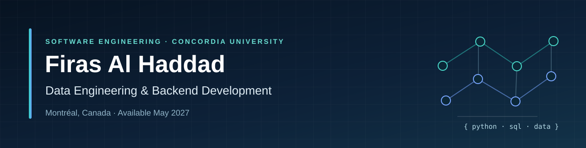
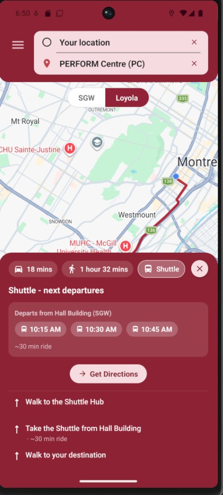
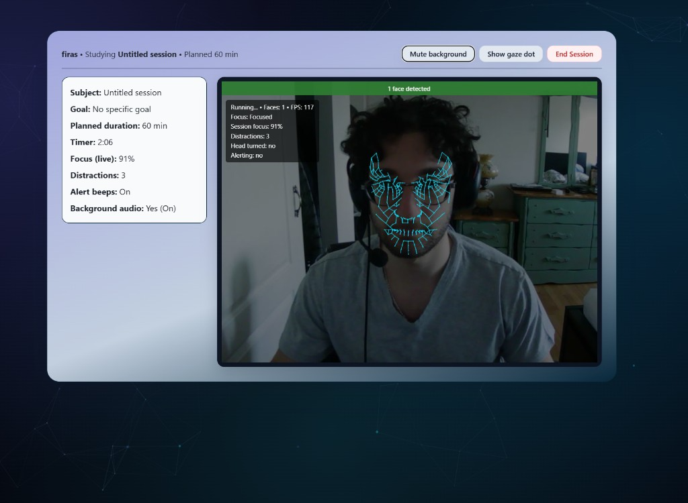
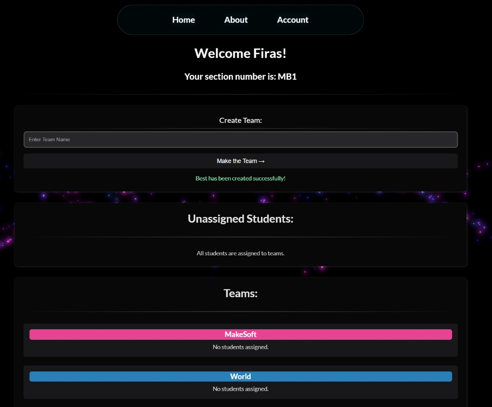
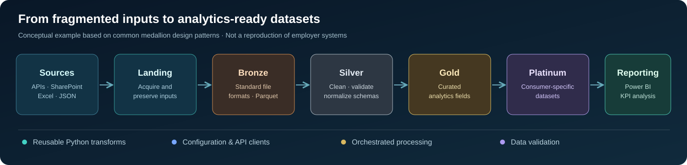

# Developer Portfolio

**A project-focused portfolio built with Next.js, TypeScript and Tailwind CSS**

[**Live portfolio**](https://firas-portfolio-zhdz.vercel.app/) · [GitHub profile](https://github.com/Lemonada10) · [LinkedIn](https://www.linkedin.com/in/firas-al-haddad-207a26280/) · [Résumé](https://firas-portfolio-zhdz.vercel.app/CV/CV.pdf)

## About this repository

The source code for my personal portfolio website. It presents my experience building **Python-based data pipelines, API integrations, analytical dashboards, backend functionality, and full-stack software projects**.

The site is designed to help reviewers quickly navigate from a concise professional summary to real repositories, case studies, screenshots and engineering decisions.

## Featured case studies

| Project | What it shows | Source |
| --- | --- | --- |
| **Campus Guide** | React Native / TypeScript navigation application; I contributed front-end experiences and automated tests in a team project. | [Repository](https://github.com/SOEN-390-MakeSoft/SOEN-390-MakeSoft) |
| **Focus Tracker** | React app using browser-side facial landmark tracking, user-facing feedback, and analysis/exports; team project. | [Repository](https://github.com/Anthony4044/Focus-Tracker-AI) |
| **Peer Review** | Full-stack instructor/student peer-evaluation workflows using React, Spring Boot, and PostgreSQL; team project. | [Repository](https://github.com/Anthony4044/MakeSoft-SOEN341_Project_F24) |

<table>
  <tr>
    <td align="center"> Campus Guide</td>
    <td align="center"> Focus Tracker</td>
    <td align="center"> Peer Review</td>
  </tr>
</table>

## Professional engineering experience

Across internships at **Pratt & Whitney Canada** and **Fonex Data Systems**, I've worked on data-source consolidation, reusable PySpark/Python transformations, medallion-pattern ETL pipelines, API and currency/unit integrations, Power BI reporting, and Python desktop utilities communicating with hardware over Bluetooth Low Energy.

This site features the following **conceptual** pipeline illustration:

**Privacy note:** the diagram is illustrative. Employer source code, private datasets, configuration, metrics, and internal architecture are not included in this public repository.

## Tech stack

- **Framework:** Next.js 14 App Router, React, TypeScript
- **UI:** Tailwind CSS, Framer Motion, shadcn/ui, Lucide, next-themes
- **Content:** Typed and centralized in \`src/lib/data.ts\`
- **Pages:** Home + project case-study routes
- **Deployment:** Vercel

## Run locally

Requires Node.js and npm.

\`\`\`bash
git clone https://github.com/Lemonada10/Firas_Portfolio.git
cd Firas_Portfolio
npm install
npm run dev
\`\`\`

Visit [http://localhost:3000](http://localhost:3000).

| Command | Purpose |
| --- | --- |
| \`npm run dev\` | Start the local development server |
| \`npm run build\` | Create a production build |
| \`npm run start\` | Start the production server |
| \`npm run lint\` | Run ESLint |

## Repository guide

- \`src/lib/data.ts\` — professional experience, project summaries, skills and links
- \`src/app/\` — app routes, layout, metadata and pages
- \`src/components/sections/\` — main portfolio sections
- \`src/components/ui/\` — reusable UI elements
- \`public/projects/\` — project screenshots and illustrations
- \`public/profile/\` — profile header and illustrative engineering diagram
- \`github-profile/README.md\` — copy-ready GitHub profile README, for the special \`Lemonada10/Lemonada10\` repository

## Contact

**Firas Al Haddad** · Montréal, Québec · Software Engineering B.Eng. (Concordia University, expected May 2027)

[Portfolio](https://firas-portfolio-zhdz.vercel.app/) · [LinkedIn](https://www.linkedin.com/in/firas-al-haddad-207a26280/) · [Email](mailto:Firas.haddad.h@gmail.com)
