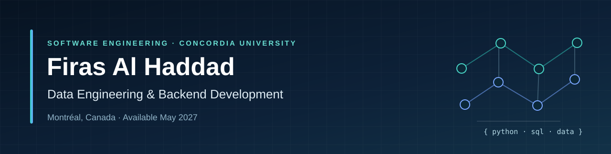
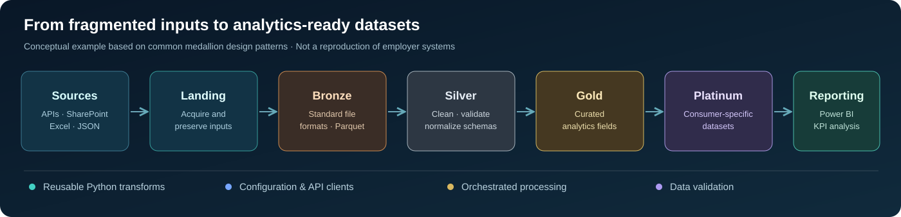
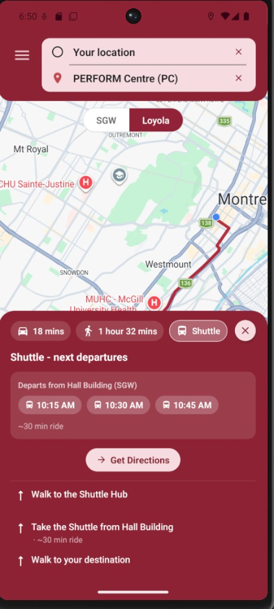
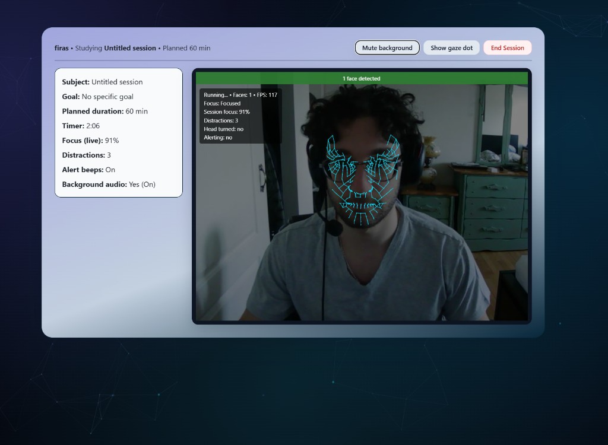
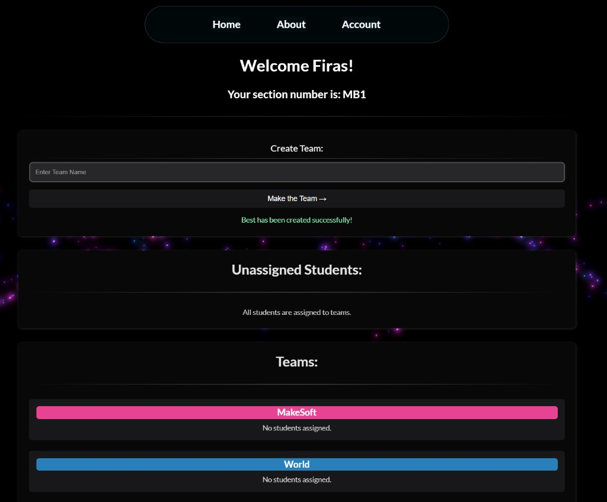

**Software Engineering Co-op @ Concordia University · Montréal, Québec**

**Seeking full-time Data Engineering / Backend / Software Engineering roles starting May 2027**

[Portfolio](https://firas-portfolio-zhdz.vercel.app/) · [LinkedIn](https://www.linkedin.com/in/firas-al-haddad-207a26280/) · [Email](mailto:Firas.haddad.h@gmail.com) · [Résumé](https://firas-portfolio-zhdz.vercel.app/CV/CV.pdf)

### What I build

I enjoy engineering the systems behind useful products: **Python data pipelines, API integrations, data models, backend services, and user-facing applications**. My internships gave me experience working with production reporting systems, real hardware, automated testing, and cross-team development workflows.

- **Data engineering:** ETL/ELT, Parquet, data cleaning and validation, reusable transformations, orchestrated pipelines.
- **Software engineering:** Python, Java, TypeScript, REST APIs, asynchronous programming, full-stack applications.
- **Delivery:** Git, pull requests, CI/CD, code reviews, and technical collaboration across teams.

### Engineering experience

| Organization | What I worked on |
| --- | --- |
| **Pratt & Whitney Canada** · 2026 | Built modular Python pipelines for SharePoint and API data, organized transformations in a medallion architecture, and prepared curated datasets for Power BI reporting. Integrated market-data APIs with currency and unit normalization; helped establish Git/PR practices for a distributed team. |
| **Fonex Data Systems** · 2025 | Built a Python/Tkinter desktop utility communicating with an optical-transceiver configuration device using BLE, `bleak`, and `asyncio`. Supported device testing and mobile-app QA. |
| **Pratt & Whitney Canada** · 2025 | Consolidated **20+ Databricks data sources** into curated reporting datasets, refactored PySpark transformations, added tests, and improved high-level parts-sales KPI reporting. |

> Employer source code, datasets, credentials, and business-sensitive implementation details are not published here. The architecture below is **illustrative**, not a diagram of an internal production system.

### Data engineering approach

I focus on separating **ingestion**, **storage**, **standardization**, **business transformations**, and **consumption**—with maintainable functions and clear data contracts between stages.

### Selected public projects

| Project | Engineering highlights | Links |
| --- | --- | --- |
| **Campus Guide** (team project) | React Native / TypeScript application for indoor and outdoor campus navigation, map interactions, and class-based routing. Contributed frontend screens and tests. | [Code](https://github.com/SOEN-390-MakeSoft/SOEN-390-MakeSoft) · [Case study](https://firas-portfolio-zhdz.vercel.app/projects/concordia-campus-guide) |
| **Focus Tracker** (team project) | Browser-based attention-estimation app with webcam landmarks, real-time feedback, session history, and Excel exports. Contributed React interfaces and reporting features. | [Code](https://github.com/Anthony4044/Focus-Tracker-AI) · [Case study](https://firas-portfolio-zhdz.vercel.app/projects/mindfulness-focus-tracker-ai) |
| **Peer Review** (team project) | Full-stack peer-evaluation app with student/instructor workflows, REST APIs, relational data, and role-aware UI. | [Code](https://github.com/Anthony4044/MakeSoft-SOEN341_Project_F24) · [Case study](https://firas-portfolio-zhdz.vercel.app/projects/peer-review-web-app) |
| **Portfolio website** | Next.js, TypeScript, Tailwind CSS, structured project case studies, responsive UI. | [Code](https://github.com/Lemonada10/Firas_Portfolio) · [Live site](https://firas-portfolio-zhdz.vercel.app/) |

**Selected merged contributions (my pull requests):** [Indoor navigation and travel-time UI](https://github.com/SOEN-390-MakeSoft/SOEN-390-MakeSoft/pull/259) · [Cross-campus shuttle routing and tests](https://github.com/SOEN-390-MakeSoft/SOEN-390-MakeSoft/pull/179) · [Focus Tracker UI foundation](https://github.com/Anthony4044/Focus-Tracker-AI/pull/3) · [Peer Review sign-in tests](https://github.com/Anthony4044/MakeSoft-SOEN341_Project_F24/pull/149).

**Project snapshots**

### Technologies I work with

| Area | Tools |
| --- | --- |
| **Languages** | Python · SQL · Java · TypeScript / JavaScript |
| **Data & analytics** | Pandas · PySpark · Databricks · Parquet · Power BI · DAX · Power Query |
| **Backend & frontend** | REST APIs · Spring Boot · React · React Native · Next.js · PostgreSQL |
| **Engineering tools** | Git · Azure DevOps · Docker · CI/CD · Unit testing · SonarQube · QMetry |

### Let's connect

I'm completing my **B.Eng. in Software Engineering at Concordia University in May 2027** and am interested in early-career roles in **data engineering, backend engineering, and software engineering**.

**[Portfolio](https://firas-portfolio-zhdz.vercel.app/) · [LinkedIn](https://www.linkedin.com/in/firas-al-haddad-207a26280/) · [Email](mailto:Firas.haddad.h@gmail.com)**

<!-- Profile README maintained as a recruiter-focused summary. Employment systems and data remain private. -->
